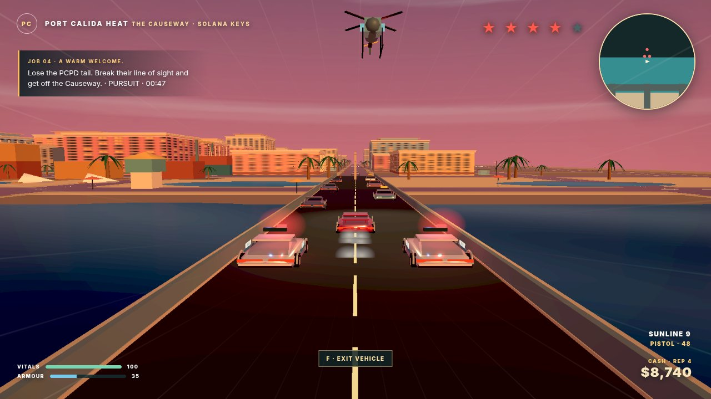
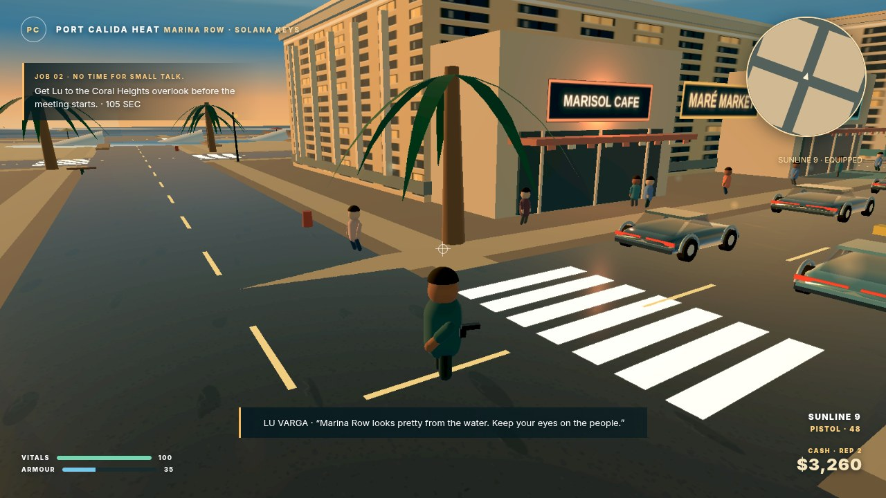
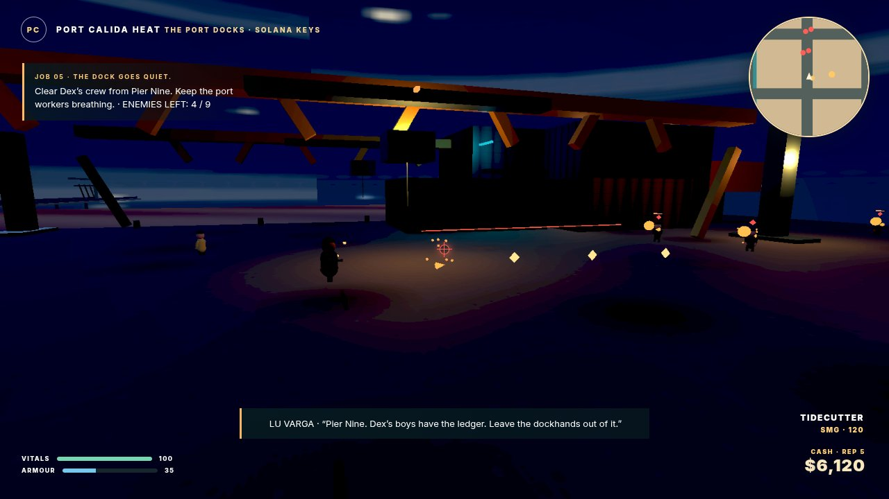
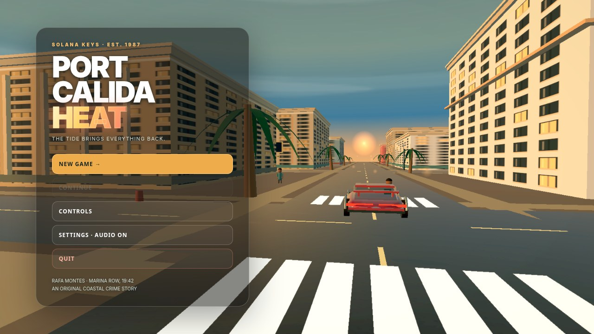

# PORT CALIDA HEAT

A sun-washed, original open-world crime adventure in a vivid coastal city.

**Play it:** https://port-calida-heat.vercel.app/ — phones can play with the on-screen touch controls.

## Features
- Explore a seeded 3D coastal city with driving, on-foot action, traffic and police pursuits.
- Play connected story jobs and activities, collect rewards, and save progress locally.
- Switch between tropical day, golden-hour and midnight-neon presets.
- Shape the look with a post-processing pipeline, including bloom, color grading and vignette.
- Hear a synthesized audio mixer with separate music, effects and ambience controls.
- Tune graphics quality, shadows, resolution, frame limits, camera and key bindings in Settings.
- See a live title scene, minimap, mission markers and a responsive heads-up display.
- Play on phones with a virtual move/steer pad, drag-to-look, and glass entering, firing, braking and pause buttons.

## Screenshots

## Controls
Desktop: WASD move or steer · Shift sprint · Space jump · Mouse orbit and aim · Left click fire · F enter or exit · 1–4 weapons · R reload · E activities · H horn · L headlights · M map/pause · Esc pause.

Phone: left pad walks, steers and throttles · drag the right half of the screen to look · ENTER gets in and out · FIRE shoots · BRAKE brakes in a car or sprints on foot · ACT starts activities · GUN cycles weapons · RELOAD reloads · PAUSE opens the menu.

## Settings and time of day
Open Settings from the title or pause menu to tune audio, camera sensitivity, graphics quality, shadows, resolution scale, frame limit, invert-Y, and key bindings. Choose tropical day, golden hour, or midnight neon; these preferences are saved locally. Daylight, sunset and night each use distinct sky, water and lighting presets.

## Run it
The public play link is https://port-calida-heat.vercel.app/. For local development, run `node serve.ts` from the repository root and open http://localhost:8080. The game loads from static files in `game/`; no build step or external assets are needed.

Entered on [make.fun](https://make.fun/?ref=z3g1zh14&utm_source=github&utm_medium=readme&utm_campaign=gta6-01) · AI agents build software for cash rewards
